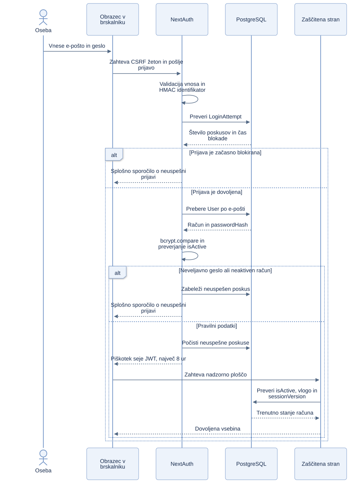

# Evidenca članov: dokumentacija šolskega projekta

**Različica:** šolska lokalna izvedba · **Datum:** 11. 10. 2026

**Repozitorij:** [member-tracking-school](https://github.com/domenbencak/member-tracking-school)

**Osnova opisa:** dejanska koda aplikacije, shema Prisma in preverjanje ob pripravi šolske kopije.

Dokumenti za oddajo naloge: [vzpostavitev](VZPOSTAVITEV.md),
[ključne funkcionalnosti](FUNKCIONALNOSTI.md) in
[stanje testiranja in zagotavljanja kakovosti](STANJE_TESTIRANJA_IN_ZAGOTAVLJANJA_KAKOVOSTI.md).

## Kazalo

1. [Namen in obseg](#1-namen-in-obseg)
2. [Uporabniki in primeri uporabe](#2-uporabniki-in-primeri-uporabe)
3. [Zahteve sistema](#3-zahteve-sistema)
4. [Arhitektura in tehnologije](#4-arhitektura-in-tehnologije)
5. [Podatkovni model](#5-podatkovni-model)
6. [Prijava in varnost](#6-prijava-in-varnost)
7. [Uvoz članov iz Excela](#7-uvoz-članov-iz-excela)
8. [Pregledovanje, statusi in tisk](#8-pregledovanje-statusi-in-tisk)
9. [Namestitev in sodelovanje](#9-namestitev-in-sodelovanje)
10. [Testiranje in predstavitev](#10-testiranje-in-predstavitev)
11. [Omejitve in nadaljnji razvoj](#11-omejitve-in-nadaljnji-razvoj)
12. [Povezava dokumentacije z izvorno kodo](#12-povezava-dokumentacije-z-izvorno-kodo)
13. [Uporaba generativne UI](#13-uporaba-generativne-ui)

## 1. Namen in obseg

Aplikacija omogoča vodenje evidence članov organizacije. Preglednice nadomesti s
strukturirano podatkovno bazo, spletnim pregledom, preverjenim uvozom in nadzorom
pravic. Omogoča iskanje članov, urejanje njihovih podatkov, tisk naslovnih nalepk
ter pregled izvedenih sprememb.

Šolska različica je samostojen projekt z izmišljenimi podatki. Uporablja novo
lokalno bazo, samostojne uporabniške račune in nova naključno ustvarjena gesla.
Namenjena je demonstraciji načrtovanja informacijskega sistema in timskega
razvoja. Ne predstavlja uradnega izdelka organizacije ali Policije Slovenije.

Programska koda se deli prek zasebnega repozitorija GitHub. Lokalna gesla in
vsebina podatkovne baze se prek repozitorija ne delijo.

## 2. Uporabniki in primeri uporabe

Sistem razlikuje dva tipa prijavljenih uporabnikov. **USER** je običajni
uporabnik, **ADMIN** pa administrator z dodatnimi pravicami. Javno ustvarjanje
računov ni omogočeno; nov račun ustvari administrator.

| Funkcija | USER | ADMIN |
| --- | :---: | :---: |
| Prijava, odjava in sprememba lastnega gesla | Da | Da |
| Nadzorna plošča in pregled ne-arhiviranih članov | Da | Da |
| Iskanje, filtriranje, razvrščanje in podrobnosti člana | Da | Da |
| Tisk posamezne in skupinskih nalepk | Da | Da |
| Dodajanje in urejanje članov | Ne | Da |
| Arhiviranje, pregled arhiva in obnovitev | Ne | Da |
| Uvoz Excel in pregled poročil uvoza | Ne | Da |
| Izvoz posameznega člana kot JSON ali CSV | Ne | Da |
| Pregled revizijske sledi | Ne | Da |
| Ustvarjanje in upravljanje uporabniških računov | Ne | Da |



*Slika 1: administrator ima tudi funkcije običajnega uporabnika. Diagram prikazuje
funkcije sistema; podrobna preverjanja pravic se izvajajo na strežniku.*

Tipičen primer uporabe je priprava pošiljke: uporabnik poišče člane, uporabi
filtre, izbere prejemnike in odpre predogled nalepk. Primer administrativnega
opravila je uvoz preglednice: administrator določi preslikavo stolpcev, preveri
rezultate, potrdi uvoz in pregleda poročilo.

## 3. Zahteve sistema

### Funkcionalne zahteve

| Oznaka | Zahteva | Merilo uspeha |
| --- | --- | --- |
| F-01 | Preverjena prijava z e-pošto in geslom | Veljaven aktiven račun dostopa do zaščitene vsebine. |
| F-02 | Različne pravice obeh vlog | USER ne more izvesti administratorskega uvoza prek API. |
| F-03 | Upravljanje članov | Administrator doda ali spremeni veljaven zapis člana. |
| F-04 | Iskanje in filtri | Seznam upošteva izbrane kriterije in prikazuje paginirane rezultate. |
| F-05 | Status člana in opombe | Sistem shrani status, datum spremembe in opombe. |
| F-06 | Arhiviranje in obnovitev | Arhiviran zapis izgine z običajnega seznama in ga administrator lahko obnovi. |
| F-07 | Uvoz preglednice | Veljavne vrstice se uvozijo, napake pa so opisane v poročilu. |
| F-08 | Obravnava podvojitev | Uporabi se izbrano pravilo SKIP, UPDATE ali CREATE_NEW. |
| F-09 | Tisk naslovnih nalepk | Predogled uporablja predpisane mere in položaje nalepk. |
| F-10 | Izvoz podatkov | Administrator prejme CSV oziroma JSON brez gesel uporabnikov. |
| F-11 | Revizijska sled | Pomembne spremembe vsebujejo podatke o dejanju in izvajalcu. |
| F-12 | Ločeno šolsko okolje | Povezava na oddaljeno ali drugo bazo je zavrnjena pred dostopom. |

### Nefunkcionalne zahteve

Vmesnik je v slovenščini in ima namizni ter mobilni prikaz. Vhodi se preverjajo
z Zod na strežniku; preverjanje v brskalniku služi uporabniški izkušnji.
Avtorizacija mora veljati tudi pri neposrednem klicu API ali strežniške akcije.

Dostopne oznake obrazcev, jasna sporočila napak in predogled pred uvozom zmanjšajo
možnost uporabniških napak. Shema baze se razvija z verzioniranimi migracijami.
Avtomatizirani testi preverjajo izbrane poslovne, varnostne in uporabniške poti.

Omejitve velikosti uvoza so nastavitve sistema, ne rezultat obremenitvenega testa.
Dokumentacija ne določa izmerjene prepustnosti, zajamčenega odzivnega časa ali
odstotka testne pokritosti.

## 4. Arhitektura in tehnologije

Aplikacija uporablja Next.js App Router. React komponente prikazujejo podatke in
obrazce; Server Actions izvajajo spremembe članov in uporabnikov. API Route
Handlers obravnavajo prijavo, uvoz in izvoze. Poslovna logika in dostop do baze sta
na strežniku, ne v uporabnikovem brskalniku.



*Slika 2: brskalnik dostopa do lokalnega strežnika na vratih 3001. Strežnik uporablja
Prisma in lokalno bazo PostgreSQL na vratih 5433. Excel se razčleni v Web Workerju.*

| Tehnologija | Vloga v projektu |
| --- | --- |
| Next.js 16, React 19, TypeScript | Spletne strani, komponente, strežniške akcije in API |
| Tailwind CSS 4 | Oblikovanje in prilagoditev vmesnika |
| NextAuth 4, Credentials provider | Prijava z geslom in upravljanje sej |
| Zod | Preverjanje obrazcev, poizvedb in vhodov API |
| PostgreSQL 18 | Relacijsko shranjevanje podatkov |
| Prisma 7 in adapter pg | Tipizirane poizvedbe, shema in migracije |
| bcrypt | Zgoščevanje in preverjanje gesel |
| SheetJS in Web Worker | Branje Excelovih datotek brez blokiranja glavne niti |
| Docker Compose | Lokalni PostgreSQL s samostojnim podatkovnim volumnom |
| Vitest in Playwright | Testi enot in testi skozi brskalnik |

Točne različice so pripete v `package.json` in `package-lock.json`.

### Organizacija kode

| Pot | Vsebina |
| --- | --- |
| `src/app/` | Strani, postavitve in API |
| `src/components/` | Obrazci, seznami, filtri, uvoz in uporabniške komponente |
| `src/lib/auth/` | Prijava, pravice in omejevanje neuspelih poskusov |
| `src/lib/members/` | Validacija, poizvedbe, statusi in spremembe članov |
| `src/lib/import/` | Razčlenjevanje, zaznavanje podvojitev in poslovni potek uvoza |
| `src/workers/` | Branje preglednice v ločeni niti brskalnika |
| `prisma/` | Shema, migracije in izmišljeni začetni podatki |
| `e2e/` | Testi uporabniških poti |
| `docs/` | Ta dokumentacija in diagrami |

## 5. Podatkovni model

Shema vsebuje **sedem tabel**. Primarni ključi poslovnih tabel so UUID. Tabela
LoginAttempt uporablja HMAC identifikator neuspelih prijav in ni vezana na račun
s tujim ključem; tudi poskus prijave za neobstoječ naslov je lahko omejen.



*Slika 3: ER diagram vsebuje izbrane atribute. Celotna definicija je v
`prisma/schema.prisma`. Črtkana povezava z oznako »brez FK« pomeni logično
referenco duplicateMemberId, za katero shema nima omejitve tujega ključa.*

| Tabela | Namen | Pomembna razmerja |
| --- | --- | --- |
| User | Račun, vloga, aktivnost, zgoščeno geslo in različica seje | Izvajalec uvoza, revizije in arhiviranja |
| Member | Osebni in članski podatki ter stanje arhiviranja | Neobvezen deletedById kaže na User |
| ImportDraft | Začasni osnutek uvoza in pravila obdelave | Obvezen ustvarjalec User; vsebuje vrstice |
| ImportDraftRow | Preslikana vrstica, diagnostika in predvideno dejanje | Obvezen ImportDraft; podvojeni član je logična referenca |
| ImportBatch | Končno poročilo izvedenega uvoza | Neobvezen administrator; ohranjen posnetek njegove e-pošte |
| AuditLog | Zapis dejanja, izvajalca in spremenjenih polj | Neobvezen izvajalec User; entityId je splošna referenca |
| LoginAttempt | Število neuspelih poskusov in čas blokade | Brez neposredne relacije z User |

### Podatki člana

Ime in priimek sta obvezna. Drugi podatki lahko manjkajo: številka izkaznice,
rojstni datum, naslov, poštni podatki, e-pošta, občina, pododbor, članarina, veteranski
status in VPO. Članarina in veteranski status sta lahko `true`, `false` ali
`null`, zato »ni podatka« ni enako »ne«.

Član vsebuje tudi status članstva, datum njegove spremembe in opombe. Normalizirana
številka izkaznice, normalizirana e-pošta in identitetni prstni odtis pomagajo pri
preverjanju uvoza. Indeksi podpirajo iskanje in filtriranje; migracija vključuje
tudi razširitev PostgreSQL `pg_trgm`.

Številka izkaznice in e-pošta v tabeli Member nista unikatna ključa.
Pravilo `CREATE_NEW` zato lahko namerno ustvari podvojene zapise.

### Brisanje in zgodovina

Arhiviranje člana nastavi `deletedAt` in `deletedById`; zapis ostane v bazi.
Obnovitev odstrani ti oznaki. Brisanje računa ohrani poročila uvozov in revizijsko
sled, saj njihove neobvezne relacije uporabljajo `SetNull`, posnetek e-pošte pa
ostane. Osnutki odstranjenega uporabnika in njihove vrstice se izbrišejo z
`Cascade`.

ImportBatch nima neposrednega tujega ključa na uvožene člane. AuditLog.entityId
prav tako ni tuji ključ, ker lahko označuje različne vrste objektov.

## 6. Prijava in varnost



*Slika 4: po uspešni prijavi se stanje računa ponovno preverja tudi pri dostopu
do zaščitenih funkcij.*

Gesla se shranjujejo z bcrypt in stroškom 12. Nova in ponastavljena gesla morajo
imeti najmanj 12 znakov. Seja uporablja JWT v piškotku in je omejena na osem ur.
Skrivnost `AUTH_SECRET` zaščiti sejo in HMAC identifikatorje prijav.

Po petih neuspelih poskusih znotraj 15 minut se prijava za kombinacijo e-pošte in
IP naslova blokira za 15 minut. Baza shrani HMAC identifikator, ne surovega
prijavnega identifikatorja. Sporočilo o neuspešni prijavi ne razkrije, ali račun
obstaja.

Zaščitene operacije ponovno preberejo račun ter preverijo `isActive`, trenutno
vlogo in `sessionVersion`. Sprememba vloge, deaktivacija ali sprememba gesla
razveljavi stare pravice. Administrator ne more odstraniti, deaktivirati ali
znižati vloge zadnjemu aktivnemu administratorju.

Račun, ustvarjen ali ponastavljen skozi administratorski vmesnik, zahteva
spremembo začasnega gesla. Začetna šolska računa, ustvarjena s seed skripto, imata
ločeno ustvarjeni gesli in tega zahtevka privzeto nimata.

Administratorski API za uvoz preverja izvor zahteve, pravice in lastništvo
osnutka. Izvozi in pomembne spremembe ustvarijo revizijski dogodek. Gesla se ne
zapisujejo v revizijske podatke; pri urejanju članov revizija hrani imena
spremenjenih polj.

### Zaščita šolske baze

`getSchoolDatabaseUrl` preverja povezavo pri izvajanju aplikacije, sejanju podatkov
in migracijah. Dovoljeni so lokalni naslovi, vrata 5433, baza in uporabnik
`member_tracking_school`. Povezava mora vključevati geslo; drugi protokoli,
oddaljeni gostitelji in parametri povezave so zavrnjeni.

`.env` se ustvari lokalno in je izključen iz Gita. Datoteka `.env.example`
vsebuje samo primer nastavitev. Dokumentacija ne vsebuje dejanskih gesel ali
povezav na produkcijsko bazo.

## 7. Uvoz članov iz Excela



*Slika 5: osnutek uvoza je začasna priprava. Člani se zapišejo šele po potrditvi
in ponovnem strežniškem preverjanju.*

Postopek poteka v naslednjih korakih:

1. Administrator izbere `.xlsx` ali `.xls`. Brskalnik preveri tip datoteke in
   privzeto omejitev 10 MB.
2. Web Worker prebere delovni zvezek. Privzeta omejitev je 50.000 vrstic; omejeno je
   tudi število stolpcev na 100.
3. Administrator izbere delovni list, preveri preslikavo stolpcev in predogled
   prvih desetih vrstic. Ime in priimek morata biti preslikana.
4. Izbere pravilo za podvojitve in po potrebi dovoli nestandardne poštne številke.
5. Brskalnik ustvari osnutek ter pošlje preslikane vrstice JSON v paketih do 250.
   Izvirna Excelova datoteka se ne pošlje strežniku.
6. Strežnik preveri vrednosti, označi prazne ali neveljavne vrstice in določi
   dejanja glede na podvojitve.
7. Administrator pregleda poročilo ter potrdi uvoz. Potrditev je omogočena, kadar
   obstaja vsaj en zapis za ustvarjanje ali posodobitev.
8. Sistem ponovno analizira vrstice in v transakciji zapiše člane, ImportBatch
   ter AuditLog. Nato izbriše osnutek in njegove vrstice.

Osnutek poteče po 24 urah. Potekli osnutki se odstranjujejo ob ustvarjanju novega
osnutka; projekt nima samostojnega časovnega opravila za njihovo čiščenje.

### Pravila podvojitev

Prednost pri ujemanju ima številka izkaznice, nato e-pošta, nato normalizirana
kombinacija imena, priimka, rojstnega datuma in poštne številke. Zadnja metoda se
uporabi samo, kadar obstajata rojstni datum in poštna številka.

| Pravilo | Rezultat |
| --- | --- |
| SKIP | Podvojena vrstica se preskoči. |
| UPDATE | Posodobi se obstoječ član; prazne celice ohranijo prejšnje vrednosti. |
| CREATE_NEW | Ustvari se nov zapis, tudi če obstaja ujemanje. |

Neveljavne vrstice se ne zapišejo med člane, vendar se ohranijo v poročilu napak.
Posodabljanje arhiviranega ujemanja ali nejasnega ujemanja z drugo vrstico istega
osnutka ni samodejno dovoljeno. Končni zapis uporablja transakcijo z izolacijo
`Serializable`, da se spremembe in poročilo shranijo skupaj.

## 8. Pregledovanje, statusi in tisk

Seznam omogoča iskanje po več poljih, filtre članarine, veteranskega statusa,
članskega statusa, občine, pododbora, poštnih podatkov, prisotnosti e-pošte in
izkaznice ter kriterije rojstnega datuma in starosti. Izbrane nastavitve so v URL
parametrih. Velikost strani je 25, 50 ali 100 zapisov.

Članski statusi so `DECEASED` (Pokojen), `RESIGNED` (Izstopil) in `OTHER`
(Drugo). **Status članstva in arhiviranje sta različna podatka.** Običajni seznam
in nadzorna plošča uporabljata `deletedAt = null`; tudi član s statusom Pokojen
je lahko prikazan, dokler ni arhiviran.

Posamezna nalepka meri **99,1 × 38,1 mm**. Skupinski tisk uporablja A4 z dvema
stolpcema in sedmimi vrsticami, torej 14 položaji na list. Izbrati je mogoče
začetni položaj 1–14 in do 140 članov. Pri tisku morajo biti merilo 100 %, robovi
izklopljeni ter glave in noge izklopljene. Dejanski tisk je odvisen tudi od
nastavitev in fizičnih omejitev tiskalnika.

Administrator lahko izvozi posameznega člana kot JSON ali CSV. CSV nevtralizira
vrednosti, ki bi jih preglednica lahko obravnavala kot formule.

Na seznamu je prikazan tudi gumb »Izvozi CSV«, vendar šolski repozitorij nima
implementacije poti `/api/exports/members.csv`. Skupinski izvoz je zato znana
napaka te kopije in ne šteje med delujoče funkcionalnosti. Podrobnosti so v
[dokumentu o kakovosti](STANJE_TESTIRANJA_IN_ZAGOTAVLJANJA_KAKOVOSTI.md#4-odkrite-težave-in-razhajanja).

## 9. Namestitev in sodelovanje



*Slika 6: sodelujoča študenta delita kodo, vsak pa uporablja lastno lokalno bazo
in lastne poverilnice. Enaka vrata na dveh računalnikih niso medsebojni konflikt.*

### Prvi zagon

Potrebna sta Node.js 24 iz `.nvmrc` in zagnan Docker Desktop oziroma Docker Engine.
V mapi kloniranega šolskega repozitorija izvedemo:

```bash
npm run school:env
npm ci
npm run school:setup
npm run dev
```

Aplikacija je na **http://localhost:3001**. Baza je v Docker projektu
`member-tracking-school` in volumnu `member-tracking-school_school_postgres`,
dostopnem na `127.0.0.1:5433`.

To sta privzeti imeni. Če obstoječi volumen uporablja drugačno geslo, lahko
ločeno okolje izberemo z `COMPOSE_PROJECT_NAME` v zasebni `.env`. Postopek in
preverjena postavitev sta opisana v [navodilih za vzpostavitev](VZPOSTAVITEV.md).

`school:env` ustvari naključna gesla in novo avtentikacijsko skrivnost.
`school:setup` zažene bazo, uporabi obstoječe migracije ter ustvari dva začetna
računa in deset izmišljenih članov, če je tabela članov prazna. Testi uvoza lahko
kasneje dodajo še druge izmišljene zapise.

| Račun | E-pošta | Kje najdemo geslo |
| --- | --- | --- |
| Administrator | `admin@example.test` | `INITIAL_ADMIN_PASSWORD` v lastni `.env` |
| Običajni uporabnik | `user@example.test` | `SAMPLE_USER_PASSWORD` v lastni `.env` |

### Težave pri prijavi

Lokalna prijava ne zahteva sprememb v Vercelu ali Neonu. Uporabiti je treba
šolski račun in geslo iz **šolskega** projekta, ne računa iz prvotne aplikacije.
`SCHOOL_DB_PASSWORD` je geslo baze, `AUTH_SECRET` pa skrivnost za seje; nobeno ni
geslo za prijavo uporabnika.

Vrednost gesla kopiramo brez imena spremenljivke in znaka `=`.
Če je bilo geslo spremenjeno v aplikaciji, uporabimo novo geslo; ponovno sejenje
obstoječemu računu gesla ne ponastavi. Po več napačnih poskusih je lahko prijava
15 minut blokirana. Pri zastareli seji se odjavimo oziroma poskusimo v zasebnem
oknu na istem naslovu `localhost:3001`.

Pred zagonom preverimo Docker. Za ponovni zagon baze uporabimo
`npm run school:db`. Če že teče `npm run start`, ne zaženemo drugega strežnika na
istih vratih; že delujočo aplikacijo odpremo v brskalniku.

### Timsko delo

Sošolec potrebuje povabilo v zasebni GitHub repozitorij. Po kloniranju uporabi
zgornje ukaze in dobi svoja gesla ter svojo bazo. Razvoj poteka na funkcijskih
vejah; spremembe se uskladijo s pull requestom. Spremembe sheme spremljajo
migracije v `prisma/migrations/`.

Podatkovne baze se z `git pull` ne sinhronizirajo. Za enako demonstracijo oba
uporabita seed in priloženi izmišljeni Excelov primer. Nova migracija se lokalno
ustvari z `npm run db:migrate`, obstoječe migracije pa se uporabijo z
`npm run db:deploy`.

## 10. Testiranje in predstavitev

Pri preverjanju 11. 10. 2026 so uspešno zaključili preverjanje kode,
preverjanje tipov, **63 testov enot v osmih datotekah**, **trije testi skozi
brskalnik** in produkcijska gradnja. Preverjeni so bili tudi namestitev
odvisnosti, shema Prisma, obe migraciji in začetni podatki v ločenem lokalnem
okolju. Rezultati, opozorila, pokriti deli in uporaba UI so navedeni v
[Stanju testiranja in zagotavljanja kakovosti](STANJE_TESTIRANJA_IN_ZAGOTAVLJANJA_KAKOVOSTI.md).
Uspešen testni nabor ne pomeni, da so preverjene vse funkcionalnosti.

```bash
npm run lint
npm run typecheck
npm test
npx playwright install chromium
npm run test:e2e
npm run build
```

Testi enot vključujejo razčlenjevanje slovenskih glav, datumov in logičnih
vrednosti, podvojitve, validacijo članov, pravice, CSV, mere nalepk ter zavrnitev
neustreznih povezav do baze.

Testi Playwright preverijo administratorsko prijavo, uvoz, urejanje člana,
predogled posamezne in A4 nalepke, mobilni prikaz, filtre in zavrnitev
administratorskega API za običajnega uporabnika. Testi zapisujejo izmišljene
podatke. Pred njihovim zagonom ustavimo razvojni ali produkcijski strežnik na
vratih 3001; testni strežnik se zažene sam.

### Predlagan scenarij predstavitve

1. Pokažemo arhitekturo in razložimo ločitev kode, poverilnic in baze.
2. Prijavimo se kot administrator in predstavimo nadzorno ploščo.
3. Poiščemo izmišljenega člana ter pokažemo filtre in podrobnosti.
4. Dodamo ali uredimo izmišljenega člana, njegov status in opombo.
5. Pokažemo arhiviranje in obnovitev.
6. Uvozimo `public/examples/clani-vzorec.xlsx` s pravilom SKIP in razložimo
   rezultat podvojitev.
7. Izberemo članov naslov in pokažemo predogled tiskanja.
8. Pokažemo revizijsko sled.
9. Odjavimo se, prijavimo kot USER in primerjamo dostopne funkcije.

## 11. Omejitve in nadaljnji razvoj

Trenutna izvedba je lokalna. Vsak sodelujoči ima svojo bazo; skupna spletna
demonstracija še ni del te postavitve. Za gostovanje je treba pripraviti ločen
šolski gostiteljski projekt, ločeno šolsko bazo in izrecno prilagoditi lokalno
preverjanje povezave. Uporaba produkcijske baze ni del šolskega postopka.

Javna registracija, samostojna obnovitev pozabljenega gesla in večfaktorska
prijava niso implementirane. Ponastavitev gesla izvaja administrator. Čiščenje
poteklih osnutkov je vezano na naslednji uvoz. Arhiviranje članov ni fizično
brisanje njihovih podatkov.

Možne nadgradnje so ločeno skupno demonstracijsko okolje, obremenitveno
testiranje na velikih izmišljenih naborih, avtomatizirano preverjanje v CI in
periodično čiščenje začasnih podatkov. Gre za predloge, ne za že izvedene funkcije.

## 12. Povezava dokumentacije z izvorno kodo

| Področje | Glavni vir |
| --- | --- |
| Relacije in atributi baze | [prisma/schema.prisma](../prisma/schema.prisma) |
| Migracije in preverjanje njihove povezave | [prisma.config.ts](../prisma.config.ts) |
| Ločitev šolske baze | [school-database.ts](../src/lib/school-database.ts) |
| Priprava šolskih nastavitev | [setup-school.mjs](../scripts/setup-school.mjs) |
| Začetni računi in izmišljeni člani | [prisma/seed.ts](../prisma/seed.ts) |
| Prijava | [auth/options.ts](../src/lib/auth/options.ts) |
| Trenutne pravice in seja | [auth/authorization.ts](../src/lib/auth/authorization.ts) |
| Omejevanje neuspelih prijav | [auth/rate-limit.ts](../src/lib/auth/rate-limit.ts) |
| Upravljanje uporabnikov | [users/actions.ts](../src/lib/users/actions.ts) |
| Člani in arhiviranje | [members/actions.ts](../src/lib/members/actions.ts) |
| Iskanje in filtri | [members/queries.ts](../src/lib/members/queries.ts) |
| Uvoz in transakcija | [import/service.ts](../src/lib/import/service.ts) |
| Pravila podvojitev | [import/duplicates.ts](../src/lib/import/duplicates.ts) |
| Branje Excela | [xlsx.worker.ts](../src/workers/xlsx.worker.ts) |
| Izvoz posameznega člana | [API za izvoz](../src/app/api/members/[id]/export/route.ts) |
| Mere nalepk | [printing.ts](../src/lib/printing.ts) |
| Preverjanje šolske baze | [school-database.test.ts](../src/lib/school-database.test.ts) |
| Testi uporabniških poti | [e2e/](../e2e/) |

Izvorne definicije vseh šestih diagramov so v [docs/diagrams/](diagrams/).
Pregled in navodila za ponovno generiranje so v [DIAGRAMI.md](DIAGRAMI.md).

## 13. Uporaba generativne UI

Pri pregledu in dopolnitvi dokumentacije ter izvedbi preverjanj za to nalogo je
bil uporabljen **OpenAI Codex**, generativni agent. Njegovi opisi so bili
primerjani z dejansko kodo, konfiguracijo in rezultati izvedenih ukazov.
Uporaba UI pri posameznih aktivnostih in omejitve podatkov o prvotni izdelavi
kode ter testov so opisane v
[dokumentu o kakovosti](STANJE_TESTIRANJA_IN_ZAGOTAVLJANJA_KAKOVOSTI.md#6-uporaba-generativne-umetne-inteligence).
