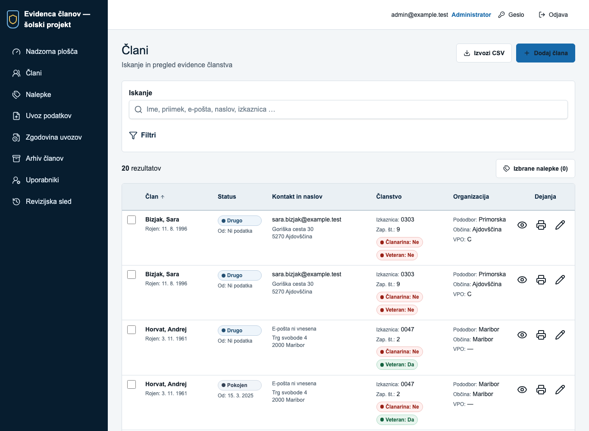
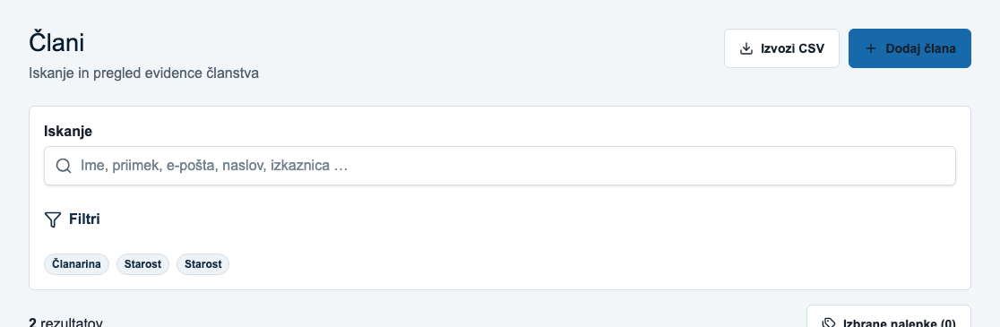
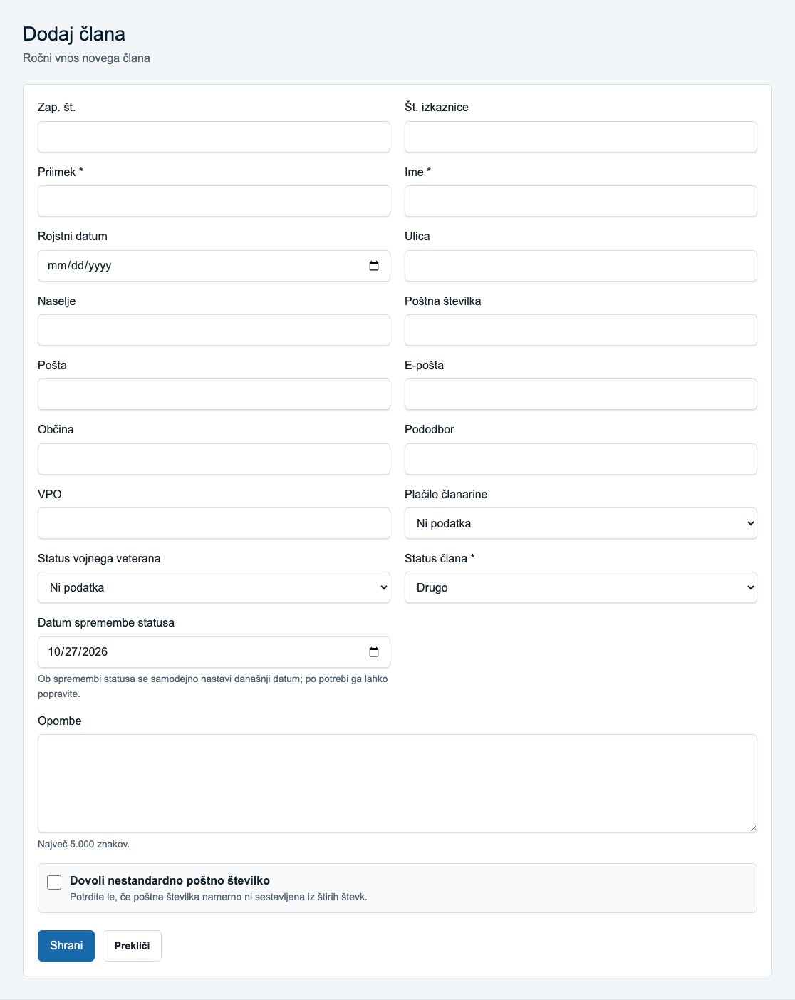
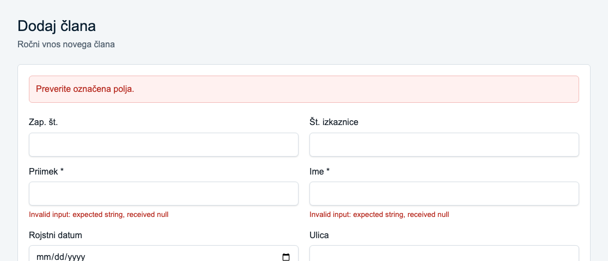
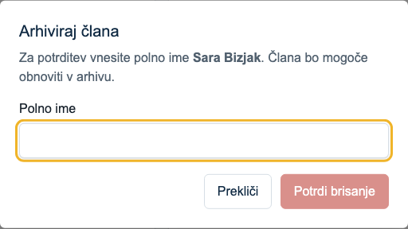
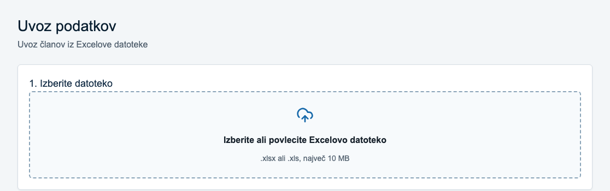
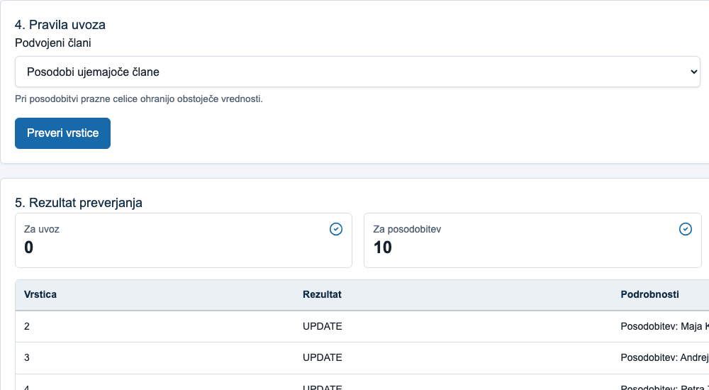
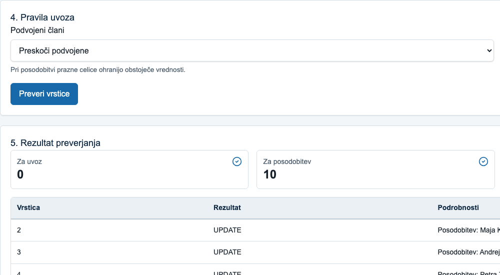

# Hevristična evalvacija evidence članov

Member Tracking School Edition · samostojna izvedba · 27. oktober 2026

**Ocenjevalec:** [ime in priimek]

## Namen in obseg

Pregled obravnava uporabnost slovenske aplikacije za evidenco članov po vseh desetih Nielsenovih hevristikah. Glavne prednosti so slovenska poimenovanja, označena obvezna polja, predogled uvoza in možnost obnovitve arhiviranih članov. Prednostno je treba obravnavati zastarel rezultat preverjanja uvoza, varovanje neshranjenega vnosa in razumljivost napak.

**Podlaga pregleda:** izvorna koda različice `036a084`, preverjanje validacije in avtomatiziran pregled lokalne aplikacije 27. oktobra 2026. Poročilo in zaslonski dokazi so pripravljeni s pomočjo Codexa. Preverjeni so bili filtri, obvezna polja, odhod z neshranjenega obrazca, potrditveno okno arhiviranja in sprememba pravil uvoza po preverjanju. Resnosti so strokovne ocene opaženih težav.

**Uporabniki:** administrator, ki ureja evidenco in uvaža člane, ter običajni uporabnik, ki išče člane in pripravlja nalepke. **Okolje pregleda:** Chromium, namizni pogled 1366 × 1000 in mobilni pogled 390 × 844. **Obseg:** prijava, seznam in filtri, obrazec člana, potrditveno okno arhiviranja ter preverjanje uvoza. Arhiviranje in končni uvoz nista bila potrjena. Uporabljeni so šolski testni podatki.

## Postopek samostojne evalvacije

Evalvacija obravnava vseh deset Nielsenovih hevristik [V4]. Pri vsaki so zapisani ustrezne rešitve, konkretna težava, vpliv, ocena resnosti in predlog izboljšave. Ugotovitve povezujejo pregled kode z odzivom delujočega vmesnika. Razporeditev težav in priporočil sledi delovnemu zvezku NN/g [V1, V2].

Posnetki S01–S08 v slikovni prilogi dokumentirajo posamezna stanja aplikacije. Dodatni mobilni posnetek S09 je shranjen v mapi `posnetki`. Statična slika sama ne dokazuje izgube vnosa ali napačnega prehoda med stanji; takšni ugotovitvi sta zato opremljeni tudi z opisom izvedenih korakov in rezultata.

## Lestvica resnosti

0 pomeni, da težave ni; 1 je kozmetična težava; 2 manjša ovira; 3 večja ovira z visoko prednostjo odprave; 4 kritična ovira pred uporabo sistema. Pri oceni upoštevamo pričakovano pogostost, vpliv in ponavljanje težave [V3]. Ocena ni enaka oceni študijske naloge.

**Oddaja:** samostojno poročilo do torka, 27. oktobra 2026, ob 17.00. Predstavitev na vajah traja tri minute.

<!-- pagebreak -->

## H1 Vidnost stanja sistema

**Ocena: delno ustrezno · resnost 2.** Dobro: shranjevanje kaže »Shranjujem …«, iskanje prikazuje dejavnost, seznam pa število rezultatov.

**Težava:** povezave glavne navigacije nimajo oznake trenutne strani. Vse dobijo isti razred; slog razlikuje le prehod kazalca in fokus. Uporabnik na podstrani težje prepozna, kateremu razdelku pripada.

**Izboljšava:** trenutni razdelek trajno poudariti in označiti z `aria-current="page"`; na podstraneh prikazati pot, npr. »Člani / Podrobnosti / Urejanje«.

**Dokaz:** S01. Na seznamu članov ni trajnega poudarka trenutnega razdelka; v navigaciji ni oznake `aria-current`. Podlaga: `src/components/app-shell.tsx`, `src/app/globals.css`.

## H2 Ujemanje sistema z resničnim svetom

**Ocena: delno ustrezno · resnost 2.** Dobro: pojmi »Članarina«, »Izkaznica« in »Pododbor« sledijo vsebini evidence.

**Težava:** rezultat preverjanja uvoza izpiše interno vrednost dejanja, npr. `UPDATE` ali `SKIP`. Končno poročilo neposredno izpiše strategijo, npr. `CREATE_NEW`. Polje »VPO« nima razlage. Za novega uporabnika pomen teh oznak ni nujno razviden.

**Izboljšava:** dejanja prevesti v »Posodobitev«, »Preskok« in »Nov zapis«, strategije opisati z istimi besedami kot v izbiri pravil. Kratico VPO pojasniti z izrazom, ki ga potrdi domenski uporabnik, in dodati primer vnosa.

**Dokaz:** S07 in S08 kažeta oznako `UPDATE`; S03 kaže nepojasnjeno kratico VPO. Podlaga: `src/components/import-wizard.tsx`, `src/components/member-form.tsx` in koda poročila uvoza.

## H3 Uporabnikov nadzor in svoboda

**Ocena: delno ustrezno · resnost 3.** Dobro: obrazec ponuja »Prekliči«, arhivirane člane pa je mogoče obnoviti.

**Težava:** obrazec člana nima zaznavanja spremenjenih podatkov ali opozorila ob odhodu. Povezava »Prekliči« in navigacija omogočata zapustitev urejanja brez potrditve. Daljši neshranjen vnos se lahko izgubi.

**Izboljšava:** spremljati spremembe in pred odhodom ponuditi »Nadaljuj urejanje« ali »Zavrzi spremembe«. Po potrebi ohraniti začasni osnutek. Opozorilo prikazati samo pri dejansko spremenjenem vnosu.

**Preverjanje:** v obrazec je bila vpisana testna opomba, nato je bila izbrana povezava »Člani«. Opozorila ni bilo; ob ponovnem odprtju obrazca je bilo polje prazno. S03 prikazuje obrazec. Podlaga: `src/components/member-form.tsx`.

<!-- pagebreak -->

## H4 Doslednost in standardi

**Ocena: delno ustrezno · resnost 2.** Dobro: aplikacija uporablja skupne gradnike gumbov in obrazcev.

**Težava:** isto dejanje ima oznake »Izbriši«, »Arhiviraj člana«, »Potrdi brisanje« in nato »Član je arhiviran«. Uporabnik ne more iz poimenovanja zanesljivo sklepati, ali je poseg trajen in ali ga lahko razveljavi.

**Izboljšava:** povsod uporabiti »Arhiviraj« in »Potrdi arhiviranje« ter po dejanju ponuditi povezavo v arhiv. Izraz »Izbriši« rezervirati za dejansko trajno odstranitev.

**Dokaz:** S05 kaže naslov »Arhiviraj člana« in gumb »Potrdi brisanje«. Okno je bilo odprto z »Izbriši« in nato preklicano. Dejanska arhivska sprememba je razvidna iz `src/lib/members/actions.ts`.

## H5 Preprečevanje napak

**Ocena: neustrezno v opisanem toku · resnost 3.** Dobro: uvoz ima predogled, zaznavanje dvojnikov in ločen korak potrditve.

**Težava:** po »Preveri vrstice« sprememba preslikave, strategije dvojnikov ali dovoljenja za poštna opozorila ne razveljavi rezultata `report`. »Potrdi in uvozi« še vedno potrjuje prej preverjeni osnutek. Uporabnik lahko pričakuje novo izbrana pravila, potrdi pa stare podatke in pravila.

**Izboljšava:** ob vsaki taki spremembi razveljaviti rezultat in onemogočiti potrditev do ponovnega preverjanja. Ob potrditvi prikazati povzetek pravil, vezan na preverjeni osnutek.

**Dokaz:** S07 in S08. Vzorčna datoteka je bila preverjena pri »Posodobi ujemajoče člane«, nato je bila izbira spremenjena v »Preskoči podvojene«. Stari rezultat je ostal prikazan in gumb »Potrdi in uvozi« je ostal omogočen. Končni uvoz ni bil potrjen.

## H6 Prepoznavanje namesto pomnjenja

**Ocena: delno ustrezno · resnost 2.** Dobro: filtri imajo stalne oznake in prikažejo seznam aktivnih pogojev.

**Težava:** značke nekaterih aktivnih filtrov kažejo samo »Status«, »Članarina« ali »Starost«, brez izbrane vrednosti. Pri starostnem razponu se lahko pojavita dve enaki znački »Starost«. Po zaprtju filtrov mora uporabnik pogoje pomniti ali jih znova odpreti.

**Izboljšava:** prikazati »Članarina: Ne«, »Status: Izstopil« in »Starost: 60–75 let«. Omogočiti odstranitev posameznega pogoja neposredno na znački.

**Dokaz:** S02. Po nastavitvi »Plačilo članarine: Ne« in starosti 60–75 let ter zaprtju filtrov so ostale značke »Članarina«, »Starost« in »Starost«. Podlaga: `src/components/member-filters.tsx`.

<!-- pagebreak -->

## H7 Prilagodljivost in učinkovitost uporabe

**Ocena: delno ustrezno · resnost 2.** Dobro: iskanje se sproži samodejno, izbor za nalepke pa se ohranja med stranmi.

**Težava:** prejemnike je mogoče označevati samo posamično. V glavi tabele ni možnosti »Izberi vse na strani«, prav tako ni skupnega čiščenja izbora. Pri več deset prejemnikih je potrebnih veliko ponovitev.

**Izboljšava:** dodati »Izberi vse na strani« in »Počisti izbor«, oboje z jasnim obsegom. Ohraniti števec izbranih članov in upoštevati omejitev 140 prejemnikov.

**Dokaz:** S01. V glavi tabele ni skupnega izbirnega polja in ob izboru ni skupnega čiščenja. Posamični izbor ter ohranjanje med stranmi določa `src/components/member-results.tsx`.

## H8 Estetsko in minimalistično oblikovanje

**Ocena: delno ustrezno · resnost 2.** Dobro: aplikacija uporablja omejeno barvno paleto; podrobnosti člana so razdeljene v vsebinske skupine.

**Težava:** obrazec za dodajanje oziroma urejanje predstavlja osebne, naslovne, organizacijske in članske podatke v eni mreži brez naslovov skupin. Na telefonu se polja razporedijo v en dolg stolpec. Struktura otežuje hiter pregled in iskanje posameznega sklopa.

**Izboljšava:** polja smiselno združiti v razdelke »Osebni podatki«, »Kontakt in naslov« ter »Članstvo«. Manj pogosto uporabljena dodatna polja po potrebi postopno razkriti.

**Dokaz:** S03 prikazuje celoten namizni obrazec. Dodatni S09 kaže začetek mobilnega obrazca. Pri širini 390 pik obrazec ne presega širine zaslona; vsebinske skupine niso označene. Podlaga: `src/components/member-form.tsx`.

## H9 Prepoznavanje in odpravljanje napak

**Ocena: neustrezno pri praznih obveznih poljih · resnost 3.** Dobro: obrazec vrne splošno opozorilo in napake ob posameznih poljih.

**Težava:** lokalni klic validatorja s praznim imenom in priimkom vrne »Invalid input: expected string, received null«. Pretvorba praznega vnosa v `null` sproži privzeto napako tipa pred predvidenim slovenskim besedilom. Polja nimajo povezave z napako prek `aria-describedby` ali oznake `aria-invalid`; fokus se ne prenese na prvo napako.

**Izboljšava:** za prazni vrednosti vrniti »Ime je obvezno« in »Priimek je obvezen«. Napake povezati s polji, jih vidno označiti in usmeriti fokus na prvo neveljavno polje.

**Dokaz:** S04. Po izbiri »Shrani« v praznem obrazcu sta se pri imenu in priimku dejansko prikazali angleški napaki. Rezultat se ujema s preverjanjem validatorja v `src/lib/members/validation.ts`.

## H10 Pomoč in dokumentacija

**Ocena: delno ustrezno · resnost 2.** Dobro: priprava nalepk vsebuje navodila za izbor in nastavitve tiskanja.

**Težava:** v navigaciji ni pomoči. Začetni zaslon uvoza ne ponuja povezave do vzorčne datoteke ali kratkih navodil za stolpce in dvojnike, čeprav vzorec v projektu obstaja. Uporabnik mora strukturo datoteke ugibati ali jo poiskati zunaj aplikacije.

**Izboljšava:** na strani uvoza ponuditi »Prenesi vzorec Excel« in kratka navodila ob preslikavi ter pravilih dvojnikov. Dodati dostopno pomoč za pogoste naloge.

**Dokaz:** S06. Začetek uvoza ponuja izbor datoteke in omejitev velikosti, ne ponuja pa prenosa vzorca ali razlage stolpcev. Vzorec obstaja v `public/examples/clani-vzorec.xlsx`.

<!-- pagebreak -->

## Predlog prednostnih izboljšav

**Najprej H5:** sprememba pravil mora zahtevati novo preverjanje uvoza. Posledica napačnega pričakovanja lahko zajame več zapisov. Uspeh: nobene potrditve zastarelega rezultata po spremembi nastavitev.

**Nato H3 in H9:** zavarovati neshranjene spremembe ter zagotoviti slovenska, dostopna sporočila o napakah. Uspeh: odhod s spremenjenega obrazca zahteva odločitev, prazni obvezni polji pa dobita konkretni slovenski napaki.

**Naslednje izboljšave:** poenotiti arhiviranje (H4), prevesti oznake uvoza (H2), izpisati vrednosti filtrov (H6), označiti trenutno stran (H1), poenostaviti izbor nalepk (H7), urediti skupine obrazca (H8) in pomoč (H10). Prioritete izhajajo iz samostojne evalvacije.

## Okvir triminutne predstavitve

**0.00–0.25:** predstavi aplikacijo, uporabnike in obseg samostojne evalvacije. Omeni pregled vseh desetih hevristik in zajem dokazov.

**0.25–1.55:** pokaži tri najpomembnejše težave. Za vsako nameni približno 30 sekund: sprožilec, posledica in izboljšava. Predlagani primeri so H5, H3 in H9; uporabi S07–S08 in S04.

**1.55–2.30:** povzemi preostale hevristike in dobre rešitve, npr. predogled uvoza in možnost preklica. Na S05 ali S02 pokaži še primer nedoslednega poimenovanja ali nejasnih filtrov.

**2.30–3.00:** predstavi prednostni vrstni red izboljšav in kako bi preveril njihov uspeh. Končaj s konkretnim kriterijem: sprememba pravil uvoza zahteva novo preverjanje.

## Viri

**V1:** Moran, K., in Gordon, K. (2023). How to Conduct a Heuristic Evaluation. NN/g. https://www.nngroup.com/articles/how-to-conduct-a-heuristic-evaluation/

**V2:** Nielsen Norman Group. Heuristic Evaluation Workbook. Predloga za zapis težav in priporočil po vseh desetih hevristikah. https://media.nngroup.com/media/articles/attachments/Heuristic_Evaluation_Workbook_1_Fillable.pdf

**V3:** Nielsen, J. (1994). Severity Ratings for Usability Problems. NN/g. https://www.nngroup.com/articles/how-to-rate-the-severity-of-usability-problems/

**V4:** Nielsen, J. 10 Usability Heuristics for User Interface Design. NN/g, pregledana spletna različica. https://www.nngroup.com/articles/ten-usability-heuristics/

**Projektni dokazi:** datoteke ob posameznih postavkah H1–H10; repozitorij Member Tracking School Edition, različica `036a084`. Spletni viri pregledani 23. oktobra 2026.

<!-- pagebreak -->

## Slikovna priloga pregled in filtri

**S01 · H1 in H7.** Seznam članov z glavno navigacijo. Trenutni razdelek ni trajno poudarjen. V glavi tabele ni skupnega izbirnega polja za prejemnike nalepk.

**S02 · H6.** Filtri so zaprti po izbiri neplačane članarine in starosti 60–75 let. Značke kažejo samo »Članarina«, »Starost« in »Starost«, ne pa dejanskih vrednosti.

<!-- pagebreak -->

## Slikovna priloga obrazec člana

**S03 · H2 in H8.** Celoten obrazec brez vsebinskih podnaslovov; polje »VPO« nima razlage. Pri H3 je bil dodatno preverjen odhod z vpisano opombo in ponovno odprtje praznega obrazca. Statični posnetek prikazuje obrazec, izgubo vnosa pa potrjuje opis prehoda v H3.

<!-- pagebreak -->

## Slikovna priloga napake poimenovanje in pomoč

**S04 · H9.** Po oddaji praznega obrazca se pri obeh obveznih poljih pojavi »Invalid input: expected string, received null«. Napaka ne pove razumljivo, kaj mora uporabnik vnesti.

**S05 · H4.** Okno, odprto z »Izbriši«, ima naslov »Arhiviraj člana«, potrditveni gumb pa »Potrdi brisanje«. Okno je bilo preklicano.

**S06 · H10.** Začetna stran uvoza brez povezave do vzorca in brez navodil za zahtevane stolpce. Prikazana sta način izbora datoteke in omejitev velikosti.

<!-- pagebreak -->

## Slikovna priloga sprememba pravil uvoza

**S07 · H2 in H5.** Preverjanje vzorca pri »Posodobi ujemajoče člane« vrne deset zapisov za posodobitev in interne oznake `UPDATE`.

**S08 · H5.** Po spremembi v »Preskoči podvojene« rezultat še vedno kaže deset posodobitev in `UPDATE`. Ponovno preverjanje ni zahtevano; omogočenost gumba za potrditev je bila preverjena ločeno. Končni uvoz ni bil izveden.
